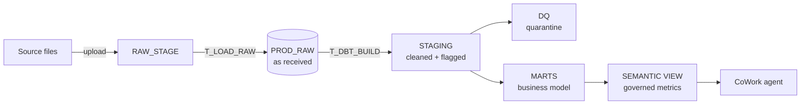
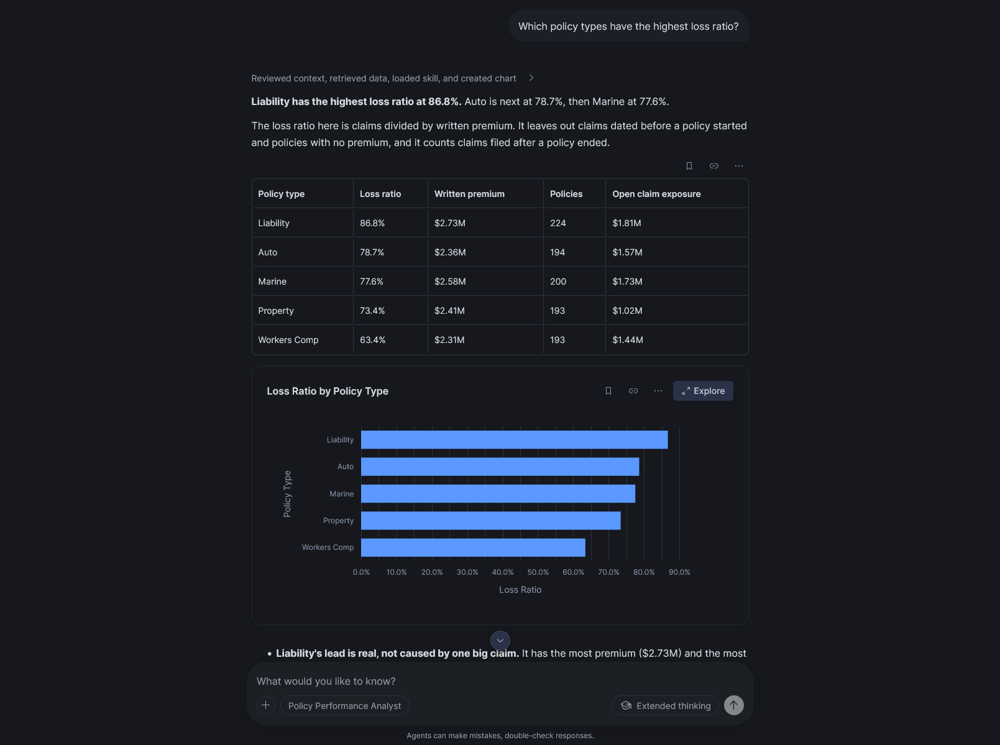
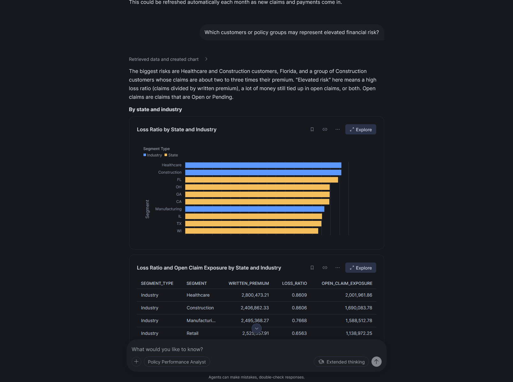
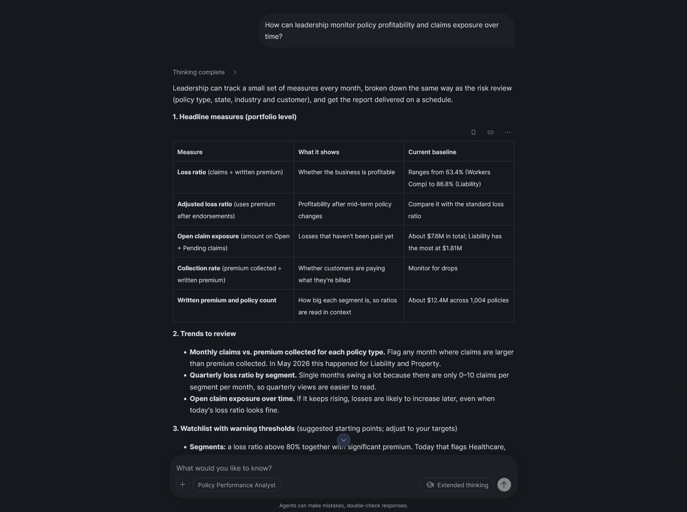

# Insurance Policy Performance on Snowflake

A curated analytics layer that answers four questions about insurance policy performance: loss ratios by policy type, claims and payment trends, elevated financial risk, and profitability over time. Everything is built, scheduled and served inside Snowflake.

The original assignment is in [ASSIGNMENT.md](ASSIGNMENT.md) and the source files are in [data/](data/).

---

## 1. My approach

Coming into this assignment, I wanted to use the technologies that match the role and what RLI uses in its own Snowflake environment. That led me to a **dbt pipeline scheduled inside Snowflake**, a **semantic view** as the metric layer, and a **CoWork agent** as the reporting layer.

**dbt.** The assignment asks for a scalable, maintainable solution that transforms raw data. dbt covers all three:
- **Scalable:** the project grows cleanly as sources and people are added. Models are modular, `ref()` builds the dependency graph, and the same code builds dev or prod.
- **Maintainable:** every model is version-controlled SQL with tests that run on every build. It fits a CI/CD workflow.
- **Transformation:** the cleaning and business rules live in readable, reviewable SQL.

**Snowflake.** Snowflake handles storage, compute, security and orchestration in one place. The pipeline runs as Snowflake tasks, so there is no outside scheduler to host or secure. It also integrates directly with Snowflake's AI features, which adds an intelligence layer on top of the data.

**CoWork.** RLI's reporting stack uses CoWork and Cortex Agents, so I built the reporting layer there. What makes it especially useful here is that it's nimble. Instead of a static dashboard, users get an interactive environment where they can build their own reports, ask follow-up questions and query ad-hoc values when they need them.

---

## 2. How to run it

Everything runs in Snowsight with a user that has **ACCOUNTADMIN** (a trial account works). Every setup script can be re-run safely.

**Step 1: Open the repo in a Snowflake workspace.** First, allow Snowflake to read the public repo:

```sql
USE ROLE ACCOUNTADMIN;
CREATE API INTEGRATION IF NOT EXISTS RLI_GITHUB_API
  API_PROVIDER         = git_https_api
  API_ALLOWED_PREFIXES = ('https://github.com/dinn16MU')
  ENABLED              = TRUE;
```

Then go to **Projects → Workspaces → Create Workspace → From Git repository**:
- Repository URL: `https://github.com/dinn16MU/rli_take_home_assignment_submission_dinni_b`
- API integration: `RLI_GITHUB_API`
- Authentication: Public repository

**Step 2: Run the setup scripts `setup/01` to `06`, in order.** Open each one in the workspace and click **Run All**. Each script switches to the role it needs.

| Script | What it creates |
|---|---|
| `01_roles_and_users.sql` | Roles, role hierarchy and the `DBT_SVC` service user |
| `02_warehouses.sql` | The three warehouses |
| `03_cost_controls.sql` | Resource monitors |
| `04_db_and_schema_grants.sql` | Dev and prod databases, schemas and grants |
| `05_stg_file_format_raw.sql` | File formats, the raw stage and the RAW tables |
| `06_masking_policy.sql` | The masking policy for customer names |

**Step 3: Upload the source files.** Download the 5 files from [docs/data](data/). In Snowsight, open **Database Explorer → PROD_RAW → INSURANCE → Stages → RAW_STAGE → + Files** and upload them.

**Step 4: Deploy the dbt project.** In the workspace, switch the role to **SYSADMIN**, open any file in the `dbt/` folder, and choose **Connect → Deploy dbt project**:
- Database `PROD_ANALYTICS`, schema `ORCHESTRATION`
- Create a dbt project named exactly `INSURANCE_ANALYTICS`

**Step 5: Schedule and run the pipeline.** Run `setup/07_schedule_pipeline.sql`. It creates the two scheduled tasks (daily at 6 AM Central) and starts one run right away. After a minute or two, both tasks show **Succeeded** under **Monitoring → Task History**.

**Step 6: Publish the CoWork agent.** After the first run succeeds, run `setup/08_cowork_agent.sql`. Then open CoWork, choose **Policy Performance Analyst** and try one of its sample questions.

> `08` turns on cross-region inference for US regions (`CORTEX_ENABLED_CROSS_REGION = 'AWS_US'`), so Cortex can use a model hosted in another US region if it isn't available locally. This is an account-level setting. Skip that line if your account already has the models it needs.

**Step 7: Check the results.**

```sql
USE ROLE ANALYST;
USE WAREHOUSE RLI_ANALYST_WH;

-- Loss ratio by policy type, straight from the semantic view
SELECT * FROM SEMANTIC_VIEW(
    PROD_ANALYTICS.SEMANTIC.SV_POLICY_PERFORMANCE
    DIMENSIONS policies.policy_type
    METRICS policy_performance.loss_ratio, policy_performance.total_premium
)
ORDER BY loss_ratio DESC;

-- Every raw claim is accounted for: 425 raw = 424 curated + 1 quarantined
USE ROLE DEVELOPER;
SELECT (SELECT COUNT(*) FROM PROD_RAW.INSURANCE.CLAIMS)              AS raw_claims,
       (SELECT COUNT(*) FROM PROD_ANALYTICS.MARTS.FCT_CLAIMS)        AS curated_claims,
       (SELECT COUNT(*) FROM PROD_ANALYTICS.DQ.DQ_QUARANTINE_CLAIMS) AS quarantined_claims;
```

---

## 3. Architecture



The build starts with the source files being uploaded into an internal stage, `RAW_STAGE`. A Snowflake task, `T_LOAD_RAW`, runs the dbt `load_raw` macro, which uses `COPY INTO` to load each file into `PROD_RAW.INSURANCE`. Every field is kept exactly as received: every column is VARCHAR, and the JSON file lands in a single VARIANT column. That way a bad value can never fail a load. These are the uncleaned copies of the source files. Each row also carries three lineage columns: which file it came from, its position in that file, and when it was loaded.

When the load finishes, a second task, `T_DBT_BUILD`, runs `dbt build`:

- **Staging** (`PROD_ANALYTICS.STAGING`, views) cleans and flags the data. Types are cast safely, text is trimmed, and data quality issues get flag columns. There is no business logic yet.
- **DQ** (`PROD_ANALYTICS.DQ`) holds the rows that can't be trusted at all, such as a duplicate claim pointing to a policy that doesn't exist. They're removed from staging so they can't distort the totals, but they're kept here with the reason, so nothing disappears without a trace.
- **Marts** (`PROD_ANALYTICS.MARTS`, tables) are built from the staging views, with the business logic applied. There are customer and policy dimensions, claim and payment facts, and one row per policy with every input the loss ratio needs. They're tables because analysts and the agent query them repeatedly.
- **Semantic view** (`SV_POLICY_PERFORMANCE`) defines the relationships between the mart tables, the dimensions to group by, and the metrics, such as the loss ratio. Each metric is defined once, with descriptions and synonyms, which gives the AI layer the context it needs to calculate things correctly.

The final piece is the reporting layer: a CoWork agent that uses the semantic view as its context and gives business users analytics in a conversational, chat experience. It handles ad-hoc requests and calculations and adds context to its answers.

**Environments.** There are two identical sets of databases: `DEV_RAW` / `DEV_ANALYTICS` and `PROD_RAW` / `PROD_ANALYTICS`, with the same schema names in each. The dbt target decides where a run goes: `dev` builds as DEVELOPER into the dev databases, and `prod` builds as SERVICE_ROLE into the prod databases. Dev databases are transient with 1 day of Time Travel, because they're cheap and can always be rebuilt. Prod keeps 7 days of Time Travel for recovery.

---

## 4. Business definitions

| Term | Definition |
|---|---|
| **Loss ratio** | Claims divided by written premium. This is the main KPI. |
| **Written premium** | The premium on each policy. Policy 6 has no premium, so it's left out of both sides of the loss ratio instead of being treated as zero. |
| **Payments** | Premium collected from customers, not claim payouts. Collection rate = premium collected / written premium. |
| **Adjusted loss ratio** | Claims divided by premium after endorsements |
| **Open claim exposure** | The amount on Open and Pending claims |

**Which claims count toward the loss ratio.** Claims dated **before** a policy started are excluded, because no coverage existed yet. Claims dated **after** a policy ended are included, because late reporting of a loss that happened during the term is a real cost.

This rule changes the headline number a lot, so here are the alternatives:

| Rule | Overall loss ratio |
|---|---|
| Count every claim | 0.87 |
| **Exclude claims before the policy started (my choice)** | **0.76** |
| Only count claims inside the policy term | 0.51 |

---

## 5. Data quality decisions

My rule is simple: if a row can't be trusted at all, quarantine it; if it's unusual but could be real, keep it and flag it. I never drop or invent data silently.

- **Duplicate and orphan records.** Claim 1 appears twice, and one copy points to a policy that doesn't exist (999999). That copy is removed from staging and kept in `DQ.DQ_QUARANTINE_CLAIMS` with the reason, so 425 raw claims = 424 curated + 1 quarantined.
- **Missing values.** Policy 6 has no premium. The row is kept with an `is_missing_premium` flag and left out of the loss ratio.
- **Invalid dates.** Policy 21 expires before it starts. It's kept and flagged as an invalid term (`is_invalid_term`).
- **Negative amounts.** Payment 11 is -$500. It's kept, because it's most likely a refund or reversal, and flagged with `is_negative_amount`.
- **Endorsement sign vs. type.** The sign of the amount doesn't match the type for 15 endorsements: 7 Coverage Increases are negative and 8 Cancellations are positive. The data is kept and the mismatches are flagged, and the type decides the sign. A Coverage Increase is always positive; a Coverage Reduction or Cancellation is always negative. Endorsements dated after a policy ended are ignored, because an expired policy can't be changed.
- **Events outside the policy term.** 60 claims are dated before their policy started and 118 after it ended. Payments and endorsements show the same pattern. There are too many for these to be typos, so I kept the data and, instead of a true/false flag, labeled each claim and payment by when it happened: `before policy start`, `during policy`, `after policy end` or `invalid policy term`. The loss ratio rule in section 4 uses these labels.

**Tests.** Every `dbt build` runs unique, not-null, relationship and accepted-value tests on the staging and mart models (`_staging.yml` and `_marts.yml`). If a test fails, everything downstream is skipped, so bad data never reaches the semantic view or CoWork.

---

## 6. Results

<!-- Add CoWork screenshots to docs/images/ and update the file names below -->

**1. Which policy types have the highest loss ratios?**

| Policy type | Loss ratio | Written premium | Policies |
|---|---|---|---|
| Liability | 86.8% | $2.73M | 224 |
| Auto | 78.7% | $2.36M | 194 |
| Marine | 77.6% | $2.58M | 200 |
| Property | 73.4% | $2.41M | 193 |
| Workers Comp | 63.4% | $2.31M | 193 |



**2. How do claims and payments trend across policy segments?**


**3. Which customers or policy groups may represent elevated financial risk?**



**4. How can leadership monitor profitability and claims exposure over time?**



> The data runs from May 2024 to May 2026, so the most recent quarter is partial. The drop in 2026 Q2 reflects incomplete data, not a real decline.

---

## 7. Snowflake administration

### Roles and users

```
SYSADMIN
├── SERVICE_ROLE   ← DBT_SVC (service user)
└── DEVELOPER
    └── ANALYST
```

I used USERADMIN to create the roles and users, and SECURITYADMIN for grants. Every custom role rolls up to SYSADMIN, so admins can always see and manage what each role owns.

| Role | Who | Access |
|---|---|---|
| **SERVICE_ROLE** | The pipeline | The only role that can write to production. It loads RAW, builds and owns everything in `PROD_ANALYTICS`, applies the masking policy, and owns the scheduled tasks. |
| **DEVELOPER** | Data engineers | Full access to dev (`DEV_RAW`, `DEV_ANALYTICS`). Read-only in prod. Inherits everything ANALYST can do. |
| **ANALYST** | Product Analytics, leadership | Reads prod `MARTS`, `DQ` and the semantic view, and uses the CoWork agent. No access to RAW or staging. |

**Service role vs. service user.** SERVICE_ROLE is the set of permissions the pipeline gets, and pipelines never run under a person's account. Inside Snowflake, the scheduled tasks are owned by SERVICE_ROLE, so every run uses exactly its privileges, with no user or password involved. `DBT_SVC` is the login for running the pipeline from outside Snowflake, for example from a CI job. It's a `TYPE = SERVICE` user, so it can't log in with a password, uses key-pair authentication, and holds only SERVICE_ROLE.

**Grants.** Future grants are set on each schema, so new objects dbt creates are readable by the right roles straight away. Read access to the semantic view is granted by dbt itself at the end of each prod run, because the view only exists after the first build.

### Warehouses

I used SYSADMIN to create the warehouses and SECURITYADMIN for the usage and monitor grants. There's one warehouse per workload, so loads, transformations and analyst queries never compete for compute, and cost can be tracked by workload.

| Warehouse | Used for | Auto-suspend | Statement timeout |
|---|---|---|---|
| `RLI_LOAD_WH` | Loading files (short bursts) | 60 s | 10 min |
| `RLI_DEV_WH` | dbt builds, both dev and scheduled prod | 60 s | 30 min |
| `RLI_ANALYST_WH` | Analyst queries and CoWork | 300 s | 5 min |

- All three are extra-small, start suspended and **auto-resume** when a query arrives, so they cost nothing while idle.
- The load and build warehouses **suspend after 60 seconds**, because batch work gains nothing from staying on.
- The analyst warehouse stays on for **5 minutes**, so repeat questions reuse its cache. It has the **shortest statement timeout**, so a runaway or AI-generated query can't run for long.
- The analyst warehouse is **multi-cluster (1 to 2)**. It scales out to handle more people at the same time, not to make one query faster.
- `RLI_DEV_WH` is named for where it started, but it's the transformation warehouse for both environments.
- DEVELOPER can use and monitor all three; SERVICE_ROLE uses the load and build warehouses; ANALYST uses only the analyst warehouse.

### Cost controls

I used ACCOUNTADMIN to set up two resource monitors:

| Monitor | Monthly limit | Notify | Suspend | Suspend immediately |
|---|---|---|---|---|
| `RM_ACCOUNT_MONTHLY` (whole account) | 50 credits | 75% | 100% | 110% |
| `RM_ANALYTICS_WH` (analyst warehouse) | 20 credits | 75% | 100% | 110% |

**Suspend** lets queries that are already running finish, while **suspend immediately** is the hard cap that cancels them. Resource monitors only cover warehouses, so I'd also recommend a Snowflake Budget for Cortex and CoWork usage.

### Protecting sensitive data

Customer names are protected with a dynamic masking policy. DEVELOPER and SERVICE_ROLE see the real names; ANALYST sees `CUST_` followed by a hash. The hash is always the same for the same name, so grouping and counting by customer still work. The policy is applied by dbt when `dim_customer` is built, so it's re-applied on every build and can't be forgotten. CoWork runs queries with the user's own role, so an analyst gets hashed names in CoWork and a developer sees real names.

### Monitoring

- **Pipeline:** Monitoring → Task History (or `INFORMATION_SCHEMA.TASK_HISTORY`) shows every run and any error. DEVELOPER can monitor the tasks but not change them.
- **Data quality:** the dbt tests run on every build, and `DQ.DQ_QUARANTINE_CLAIMS` shows exactly which rows were rejected and why.
- **Cost:** resource monitor alerts, plus `WAREHOUSE_METERING_HISTORY` for usage per warehouse.
- **Access:** `QUERY_HISTORY` by role confirms that production objects are only ever built by SERVICE_ROLE.

### Troubleshooting

1. Task History shows which task failed (the load or the build) and the error message.
2. The dbt run output shows which model or test failed.
3. I reproduce the problem in dev using the same code: in the workspace, choose Profile dev, then Build.
4. For a slow model, Query Profile shows where the time goes.
5. If a bad build reaches prod, Time Travel (7 days) can restore the previous data.

### Deploying across environments

```
Develop and test in dev (DEVELOPER, DEV_ANALYTICS)
  → push to GitHub
  → pull in the workspace and redeploy the dbt project
  → the next scheduled run builds prod as SERVICE_ROLE
```

Engineers can't write to prod, so a deploy is the only way a change reaches production. The platform setup (roles, warehouses, grants, policies, tasks and the agent) is versioned as SQL in `setup/`.

---

## 8. Alternatives I considered

| Decision | What I chose | What I didn't, and why |
|---|---|---|
| Reporting | CoWork agent on the semantic view | **Streamlit dashboard:** consistent, but it only shows the views someone built in advance. CoWork handles follow-up questions and draws charts, and masking follows each user's role automatically. |
| Orchestration | Snowflake tasks | **Airflow or dbt Cloud:** better for many pipelines across different systems, but one more system to run and secure for a pipeline that lives entirely in Snowflake. |
| Bad data | Quarantine or flag | **Dropping rows** hides problems and distorts totals (178 claims fall outside their policy term). **Fixing values** invents data. |
| RAW tables | Everything as VARCHAR | **Strict types at load:** one bad value would fail the whole file. |
| Metrics | Semantic view | **Metrics in each report:** everyone re-creates the loss ratio and some get it wrong. The semantic view defines it once for people and AI. |
| Sensitive data | Masking policy | **Secure views or a separate PII table:** more objects to maintain, and easy to get around if someone is granted the base table. |
| Environments | Database pairs in one account | **One account per environment:** stronger isolation, but too much overhead for this scope. |
| Warehouses | One per workload | **One shared warehouse:** loads, builds and analysts compete for compute, and cost can't be split by workload. |

---

## 9. Next steps

- Load files automatically from an external stage (S3) with Snowpipe, instead of uploading them by hand.
- Add CI: build and test every pull request as `DBT_SVC`, and deploy on merge.
- Add tests on the RAW sources and a freshness check, so a missed load is caught.
- Carry the endorsement `is_sign_mismatch` flag through to the marts so analysts can see it.
- Track policy changes over time with dbt snapshots.
- Add verified answers for the four core questions to the semantic view, and check the agent against them.

---

## 10. The role of AI

I made the decisions on approach, architecture, data quality and business rules. AI was my pair programmer for building them out. I used it throughout the project:

- **Learning the domain.** Insurance isn't my specialty, so I first used AI to learn the concepts and terminology: what the metrics mean and what decisions they drive.
- **Exploring the data.** With that understanding, I explored the data and found the issues that needed to be addressed.
- **Building.** I made the major decisions on architecture and data policies, and AI built out my plan.
- **Troubleshooting.** It helped me work through the problems I ran into while getting the pipeline running in Snowflake.
